<div align="center">

# Notely

**A calm, local-first desktop workspace for your projects, notes and tasks.**

Built with Electron, React and TypeScript — no account, no server, no telemetry. Just your work, stored on your machine.

[](#installation)
[](https://www.electronjs.org/)
[](https://react.dev/)
[](https://www.typescriptlang.org/)
[](https://vite.dev/)
[](#testing)
[](LICENSE)

Built and maintained by **Faceindo Developer Team** ·
[github.com/wafarifki/Notely](https://github.com/wafarifki/Notely)

</div>

---

## Screenshots

<div align="center">

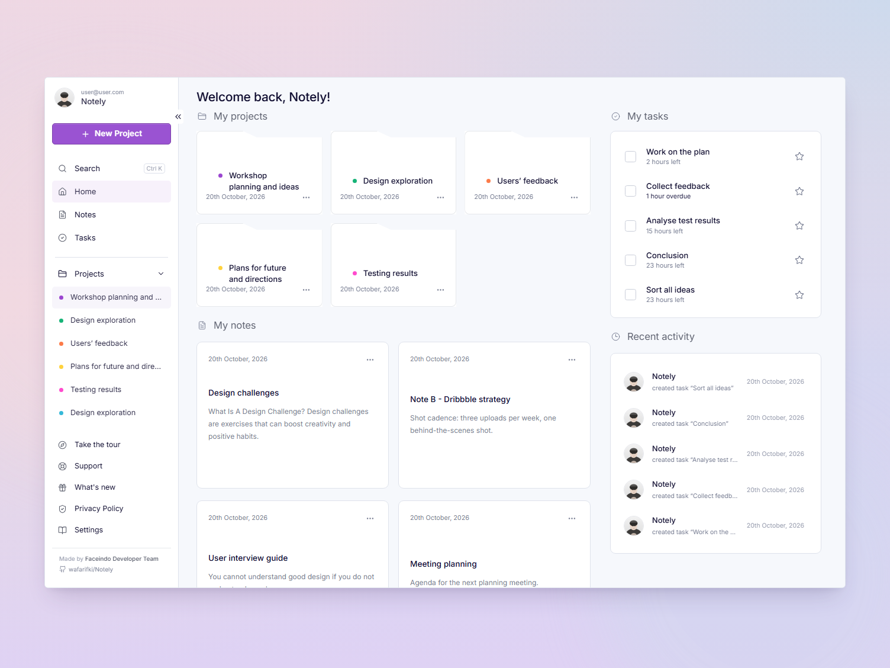

*The dashboard — projects, tasks, notes and recent activity in one view.*

</div>

| Fresh install | Notes editor |
| :---: | :---: |
| 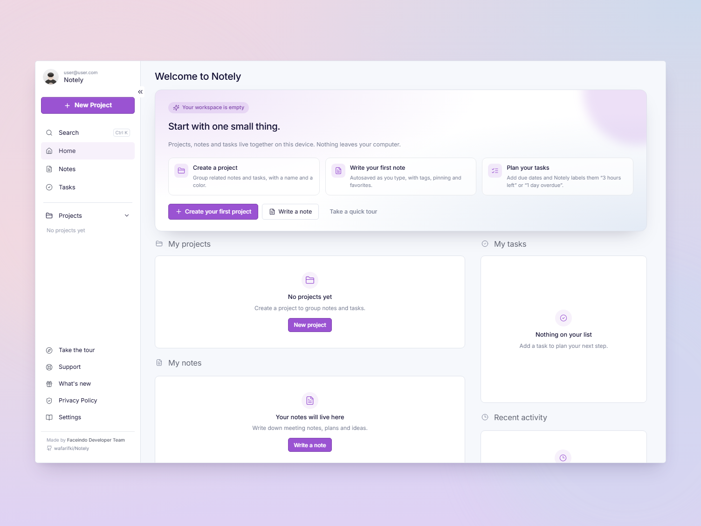 | 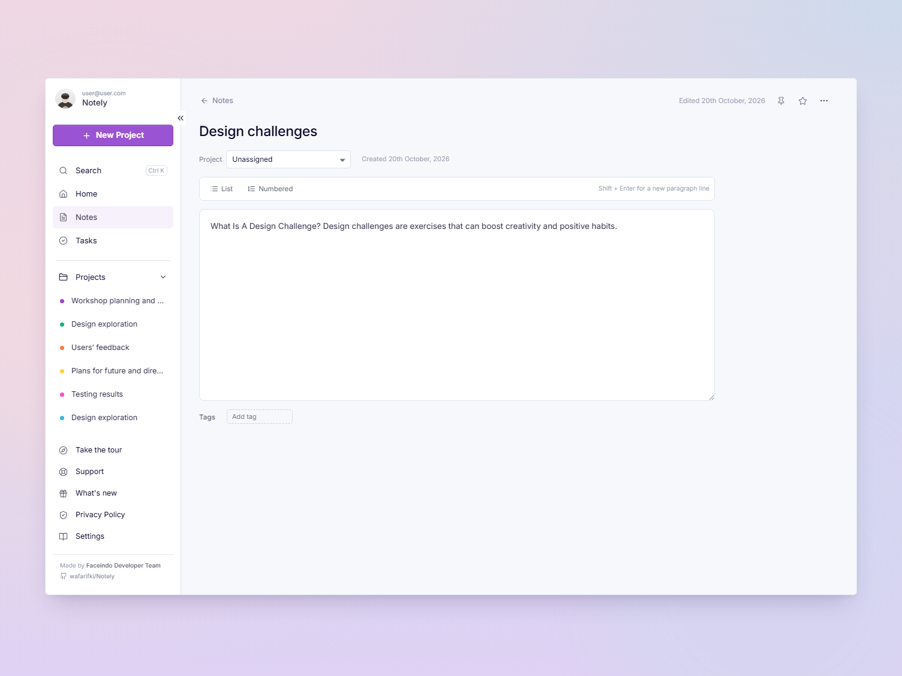 |

| Notes | Tasks |
| :---: | :---: |
| 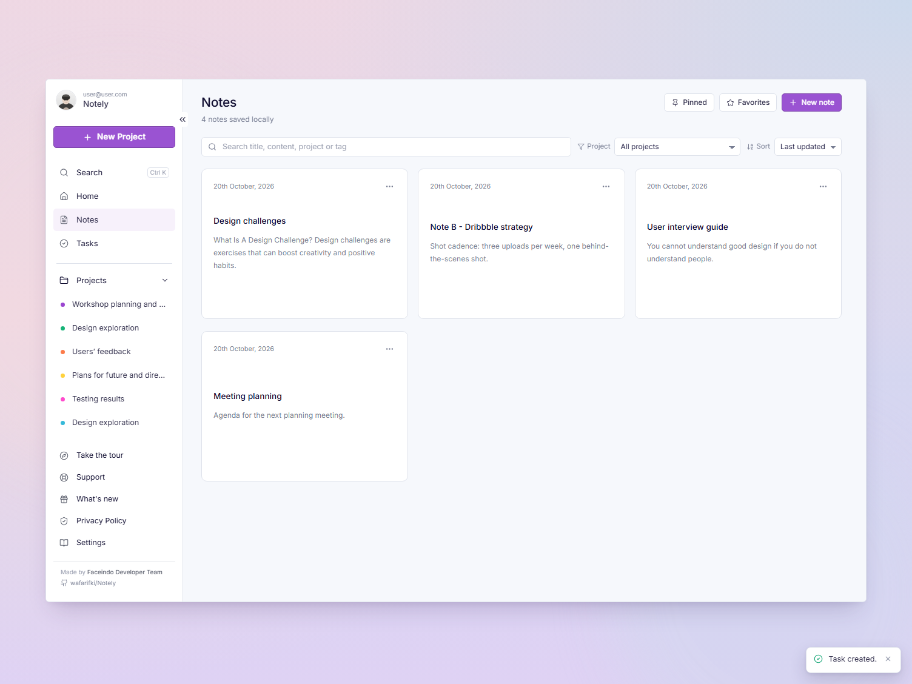 | 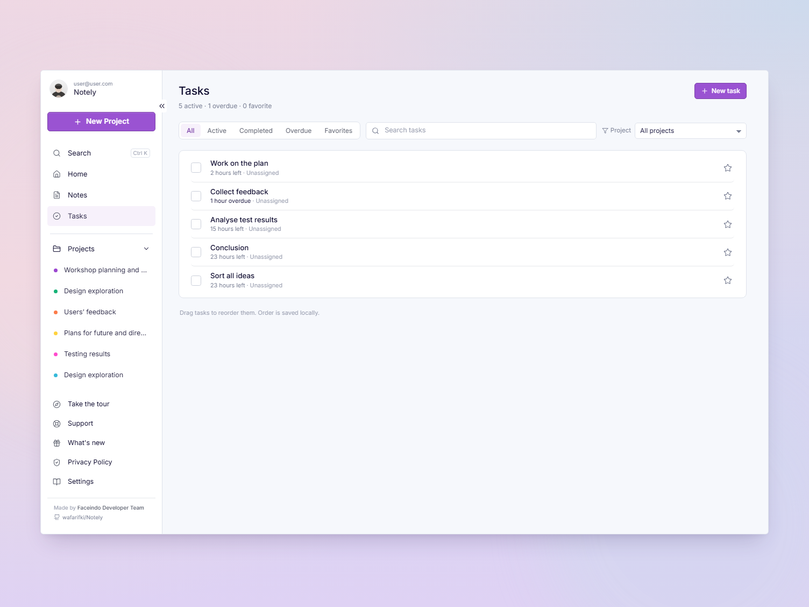 |

| Project view | Dark dashboard |
| :---: | :---: |
| 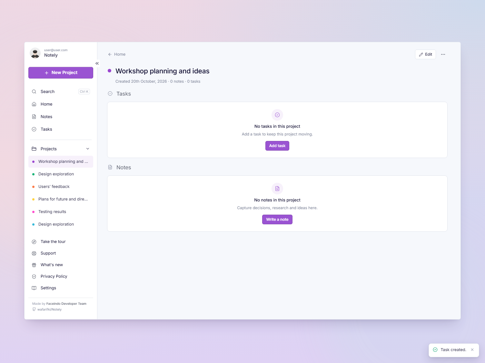 | 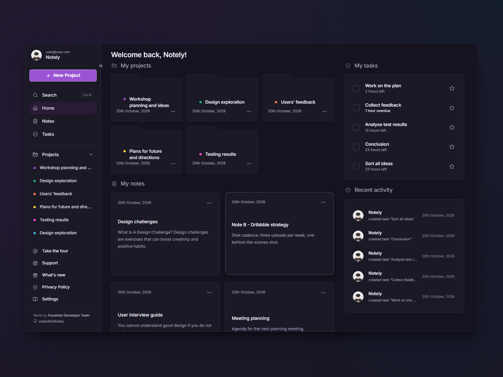 |

<div align="center">

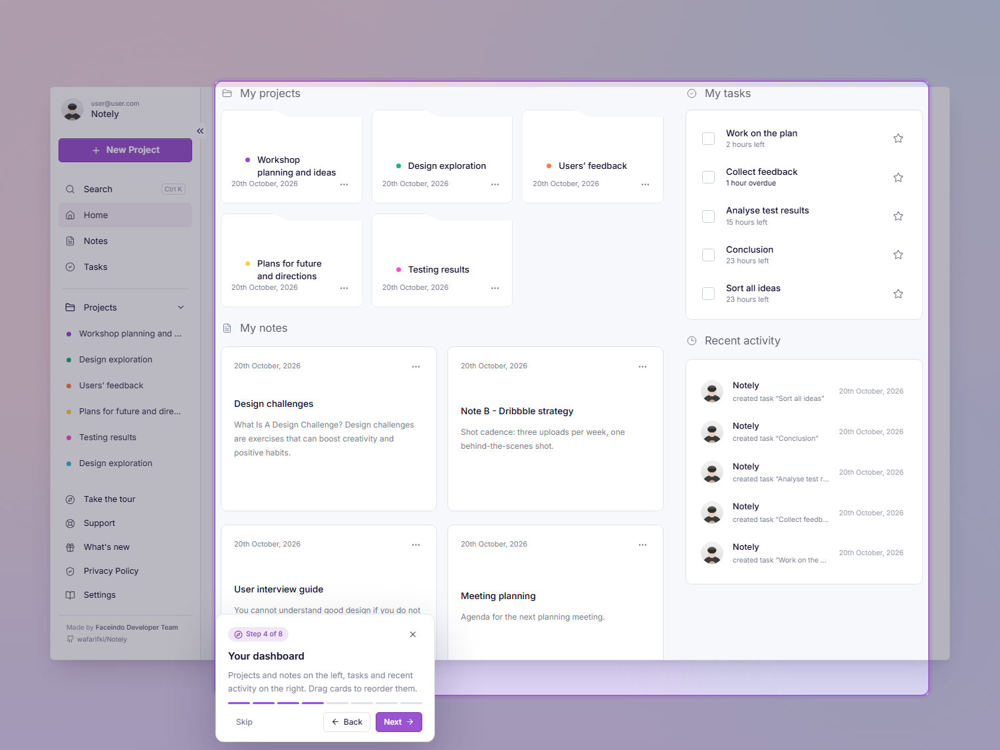

*The guided tour spotlights one thing at a time, across pages.*

</div>

<div align="center">

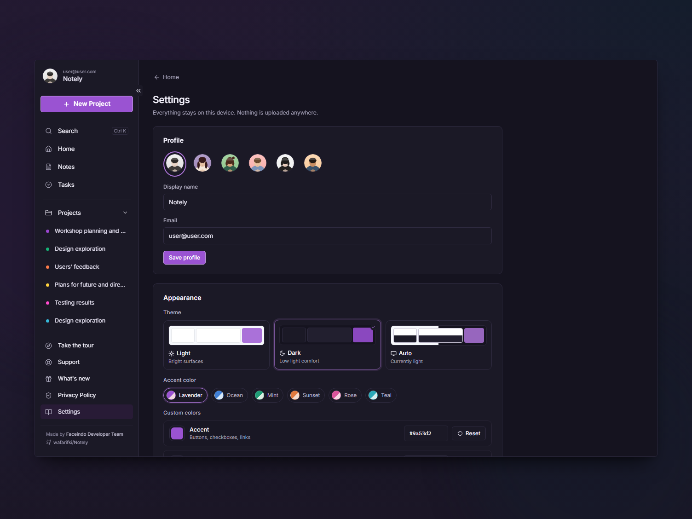

*Theme, accent presets and custom colors — all stored locally.*

</div>

<div align="center">

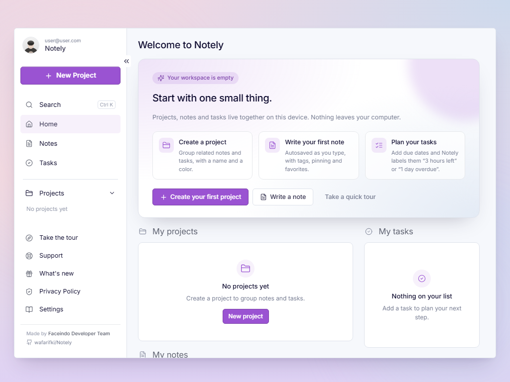
&nbsp;
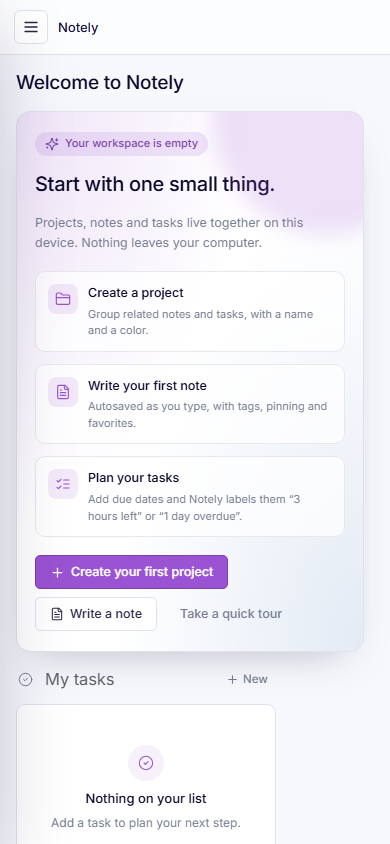

*Desktop, tablet and phone widths — the dashboard reflows, nothing overflows.*

</div>

---

## First launch

A fresh install starts **completely empty** — no demo projects, notes, tasks or activity. You get:

- A welcome card that explains the three building blocks and offers **Create your first project**,
  **Write a note** and **Take a quick tour**.
- The default profile **Notely · user@user.com**, editable any time in Settings.
- A guided 8-step tour that walks you through your profile, creating a project, search, the dashboard,
  the autosaving note editor, task filters, appearance settings and the project credits.

The tour only shows when *you* ask for it (welcome card, **Take the tour** in the sidebar, or
**Settings → Appearance → Replay the tour**). Your progress is remembered.

---

## Why Notely

Most note apps want your email, your cloud and a subscription. Notely is the opposite: one Windows app that opens
instantly, works on a plane, and keeps everything in a local database you control.

- **Local-first.** Projects, notes, tasks, tags, settings and activity live in IndexedDB on this device.
- **Offline by design.** No network calls at runtime, no accounts, no analytics, no ads.
- **Yours to move.** Export everything to JSON, import it back, or reset the workspace at any time.

---

## Features

### Projects

| | |
| --- | --- |
| Create, rename, recolor and describe projects | Archive and restore without deleting anything |
| Drag folder cards to reorder; order is saved | *Move up / Move down* in the card menu for keyboard users |
| Sidebar list and dashboard cards share one source of truth | Deleting asks: move items to **Unassigned** or delete them |

### Notes

| | |
| --- | --- |
| Autosave with `Saving…` / `Saved` / `Unable to save` | Tags, pinning, favorites and project assignment |
| Search across titles, bodies, project names and tags | Filter by project, tag, pinned or favorites |
| Sort by updated, created or title | Reorder by dragging |

### Tasks

| | |
| --- | --- |
| Live due labels: `3 hours left`, `1 hour overdue`, `1 day left` | Priority, project and free-form details |
| Filters: All, Active, Completed, Overdue, Favorites | Checkbox and star stay in sync on every page |
| Drag to reorder | Every change is written to Recent activity |

### Appearance

- **Light, Dark or Auto** (follows the Windows setting in real time).
- Six accent presets — Lavender, Ocean, Mint, Sunset, Rose and Teal.
- **Custom hex colors** for the accent and for the pastel backdrop, with color pickers.
- Optional **animated backdrop**; all motion respects `prefers-reduced-motion`.
- Every color lives in CSS tokens, so the whole UI (sidebar, cards, tags, dialogs, menus) switches together.

### Everything else

- **Search** (`Ctrl + K`) across the whole workspace, grouped by type, with arrow-key navigation.
- **Recent activity** for every create, edit, complete, move and delete.
- **Import / export**: validated JSON backup with preview, conflict count and merge/replace.
- **Settings**: profile, appearance, data management and product tour replay.
- **Support**, **What's new** and **Privacy Policy** pages are written, not dead links.

---

## Keyboard shortcuts

| Shortcut | Action |
| --- | --- |
| `Ctrl + K` | Open search |
| `Ctrl + N` | New note |
| `Esc` | Close dialog, menu, search or tour |
| `→` / `←`, `Enter` | Move through the tour or search results |

---

## Installation

### Download a build

Grab the latest `.exe` from the [Releases](https://github.com/wafarifki/Notely/releases) page.

| File | Use it if you want… |
| --- | --- |
| `Notely Setup <version>.exe` | A normal install with Start Menu and desktop shortcuts, plus an uninstaller |
| `Notely-<version>-x64-portable.exe` | A single file you can run from anywhere, no install |

> Builds are unsigned, so Windows SmartScreen may warn you. Choose *More info → Run anyway*.

### Run from source

```bash
git clone https://github.com/wafarifki/Notely.git
cd Notely
npm ci
npm run dev
```

`npm run dev` builds the Electron main process, starts Vite and opens the desktop window.

---

## Tech stack

| Layer | Choice |
| --- | --- |
| Runtime | Electron 38 (x64, frameless window with custom controls) |
| UI | React 19 + TypeScript, CSS design tokens, Lucide icons, bundled Inter |
| Build | Vite 7, electron-builder (NSIS + portable) |
| Storage | IndexedDB via Dexie 4 (schema v2) — no backend, no native database |
| Tests | Vitest, React Testing Library, fake-indexeddb |

---

## Project structure

```
src/main/            Electron main process — window, single instance lock, window-control IPC
src/preload/         Narrow contextBridge API (minimize / maximize / close)
src/renderer/
  app/               Data store (live Dexie queries), hash router, app shell, workflows
  components/        Shared primitives — modal, popover, toasts, avatar, color picker
  db/                Dexie schema, default profile, repositories, backup/restore
  data/service.ts    Business actions: CRUD + activity logging + import/export
  features/tour/     Guided product tour (spotlight overlay)
  features/          projects, notes, tasks, activity, search, settings, info pages, dashboard
  theme/             Accent presets, theme resolution and CSS variable application
  styles/            Design tokens (light + dark), shell, components, pages, motion
assets/              App icon (.ico / .png) and local avatar illustrations
docs/screenshots/    Images used in this README
scripts/             Dev runner, build, packaging, asset generator, screenshots, app verifier
tests/               Vitest suites
```

UI components never touch Dexie directly. They call `createNotesService`, which wraps the repositories and
records activity — the ESLint config enforces that boundary.

---

## Scripts

| Command | What it does |
| --- | --- |
| `npm run dev` | Desktop development: Vite + Electron |
| `npm run dev:web` | Renderer only in a browser at `http://localhost:5391` |
| `npm run lint` | ESLint (TypeScript + React hooks) |
| `npm run test` | Vitest + React Testing Library |
| `npm run typecheck` | TypeScript for renderer and Electron main/preload |
| `npm run build` | Typecheck, then bundle renderer and main process |
| `npm run dist:win` | Build and package the NSIS installer |
| `npm run dist:portable` | Build and package the portable `.exe` |
| `npm run dist:all` | Both Windows targets |
| `npm run verify:exe` | Launch the packaged app, check the dashboard renders, screenshot it |
| `npm run screenshots` | Capture the dashboard at 1504×1128, 1024×768 and 390×844 |
| `npm run assets` | Regenerate the local app icon and avatars |
| `npm run clean` | Stop leftover Notely/Electron processes and remove build output |
| `npm run reinstall` | `clean`, then `npm ci` (fixes `EPERM` when a dev server is still running) |

Build output lands in `release/`:

```
release/
├── Notely Setup 1.0.0.exe          # NSIS installer
├── Notely-1.0.0-x64-portable.exe   # portable executable
└── win-unpacked/Notely.exe         # unpacked build
```

### `npm ci` fails with `EPERM: unlink ... rollup.win32-x64-msvc.node`

That usually means a **dev server is still running** (`npm run dev` or `npm run dev:web` in another terminal or a
stale process). Windows keeps Rollup's native binary locked while Vite is loaded, so `npm ci` cannot replace it.
Stop the dev server, or run:

```bash
npm run reinstall
```

`reclaim.mjs` (also run automatically as `predev`/`postdev`) stops only Node processes whose command line points at
this project's Vite/dev script, and `clean.mjs` stops `Notely.exe`/`electron.exe` too. Both skip unrelated Node
processes on the machine.

`scripts/package-win.mjs` pre-extracts the Electron runtime and keeps electron-builder's tool cache under
`%LOCALAPPDATA%\NotelyBuildCache`. This sidesteps a Windows folder-rename (`EPERM`) failure that happens on some
non-system drives. If packaging still fails, close any running `Notely.exe` / `electron.exe`, delete `release/`
and rerun.

---

## Where your data lives

```
%APPDATA%\Notely\IndexedDB\
```

The installer only writes to the install folder; uninstalling Notely leaves your data untouched. To move to another
machine, use **Settings → Your data → Export JSON**. **Reset workspace** deletes projects, notes, tasks and activity
after a confirmation but keeps your profile and appearance settings.

Upgrading from the earlier “Notes” build? The database moved to `notely`, so old demo data is left behind in the
legacy folder and the app starts clean.

---

## Testing

```bash
npm test
```

Covered: empty fresh-install state and stable default profile, workspace reset keeping appearance, project/note/task
CRUD, checkbox and favorite persistence, search across title/content/project/tags, due-label formatting,
export/import validation (including invalid theme and color values), merge and replace imports, persistence across
reopened database connections, and deleting a project without silently losing notes and tasks. UI tests cover the
empty welcome state, task checkbox persistence, search, dark-mode switching and invalid custom colors.

---

## Continuous integration

`.github/workflows/build-windows.yml` runs on `windows-latest`: install from the lockfile, typecheck, lint, test,
build, package the NSIS installer and portable `.exe`, launch the packaged app to confirm it renders, then upload
both executables as artifacts.

---

## Design notes

The dashboard follows a centered, pastel-framed panel with a 226 px sidebar, folder-tab project cards, a compact
task panel and a two-column notes grid. Motion is intentionally quiet: a slow ambient backdrop, staggered card
entrances, a checkmark pop, and a spotlight tour — all disabled under `prefers-reduced-motion`.

- Dialogs trap focus, close on `Esc`, and return focus when closed.
- Icon buttons have accessible names; color is never the only status signal.
- Contrast was checked in both themes (muted text ≥ 4.5:1 on dark surfaces).

---

## Credits

Made by **Faceindo Developer Team** — [github.com/wafarifki/Notely](https://github.com/wafarifki/Notely)

## License

Released under the [MIT License](LICENSE). Use it, fork it, build on it — just keep the copyright notice.
