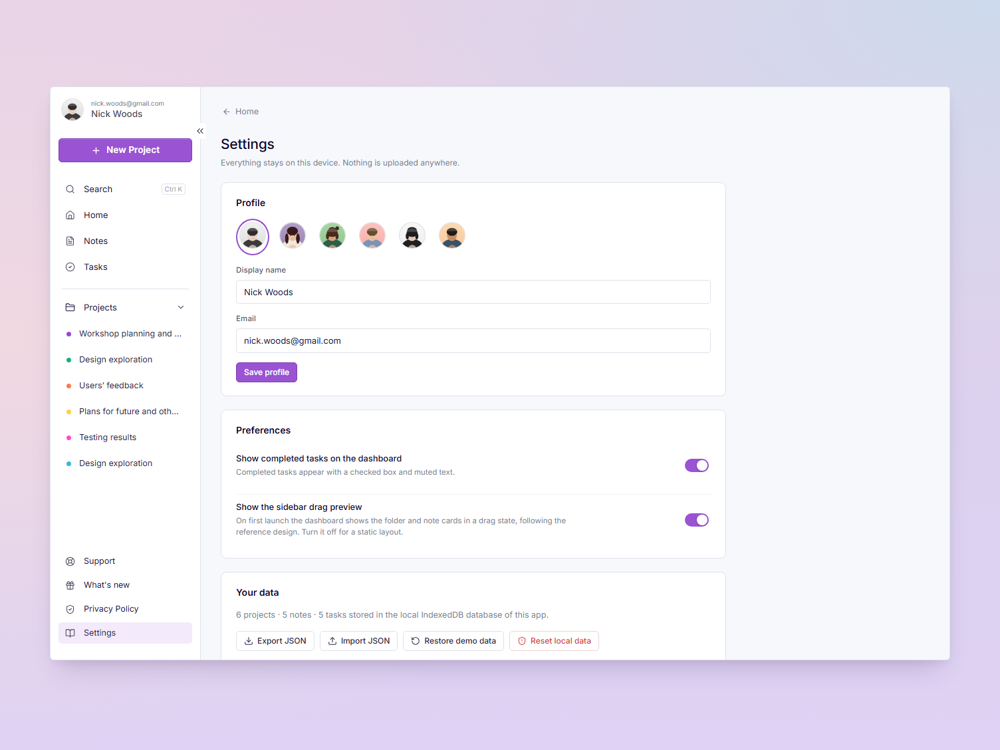

<div align="center">

# Notely

**A calm, local-first desktop workspace for your projects, notes and tasks.**

Built with Electron, React and TypeScript — no account, no server, no telemetry. Just your work, stored on your machine.

[](#installation)
[](https://www.electronjs.org/)
[](https://react.dev/)
[](https://www.typescriptlang.org/)
[](https://vite.dev/)
[](#testing)
[](LICENSE)

</div>

---

## Screenshots

<div align="center">


*The dashboard — projects, tasks, notes and recent activity in one view.*

</div>

| Notes | Tasks |
| :---: | :---: |
|  |  |

| Project view | Settings |
| :---: | :---: |
|  |  |

<sub>Screenshots are captured from the running app (`npm run screenshots`) and live in `docs/screenshots/`.</sub>

<div align="center">


&nbsp;


*Desktop, tablet and phone widths — the dashboard reflows, nothing overflows.*

</div>

---

## Why Notely

Most note apps want your email, your cloud and a subscription. Notely is the opposite: one Windows app that opens
instantly, works on a plane, and keeps everything in a local database you control.

- **Local-first.** Projects, notes, tasks, tags and activity live in IndexedDB inside the app's user data folder.
- **Offline by design.** No network calls at runtime, no accounts, no analytics, no ads.
- **Yours to move.** Export everything to JSON, import it back, or restore the demo workspace any time.

---

## Features

### Projects

- Create, rename, recolor (six palette colors), add descriptions and archive projects.
- Folder-style cards on the dashboard and the same list in the sidebar — one source of truth.
- Drag cards to reorder and the order is saved; the card menu has *Move up / Move down* for keyboard users.
- Deleting a project always asks first: **move its notes and tasks to Unassigned** or **delete them with it**.

### Notes

| | |
| --- | --- |
| Autosave with a clear `Saving…` / `Saved` / `Unable to save` status and retry | Tags, pinning, favorites and project assignment |
| Search across titles, bodies, project names and tags | Filters by project, tag, pinned or favorites |
| Sort by last updated, date created or title | Reorder cards by dragging |

### Tasks

| | |
| --- | --- |
| Due dates with live labels: `3 hours left`, `1 hour overdue`, `1 day left` | Priority, project and free-form details |
| Filters for All, Active, Completed, Overdue and Favorites | Checkbox and star stay in sync everywhere |
| Drag to reorder | Every change lands in Recent activity |

### Everything else

- **Search** (`Ctrl + K`) across the whole workspace, grouped by type, with arrow-key navigation.
- **Recent activity** recorded for every create, edit, complete, move and delete.
- **Import / export**: validated JSON backup with a preview, conflict count, and merge or replace.
- **Settings**: display name, email, avatar, dashboard preview toggle, and data management.
- **Real support pages**: Support, What's new and Privacy Policy are written, not dead links.

---

## Installation

### Download a build

Grab the latest `.exe` from the [Releases](../../releases) page (or the artifacts of a CI run).

| File | Use it if you want… |
| --- | --- |
| `Notely Setup <version>.exe` | A normal install with Start Menu and desktop shortcuts, plus an uninstaller |
| `Notely-<version>-x64-portable.exe` | A single file you can run from anywhere, no install |

> Builds are unsigned, so Windows SmartScreen may warn you. Choose *More info → Run anyway*.

### Run from source

```bash
git clone https://github.com/wafarifqi/Notely.git
cd Notely
npm ci
npm run dev
```

`npm run dev` builds the Electron main process, starts Vite, and opens the desktop window.
If npm could not download the Electron binary during install, run `node node_modules/electron/install.js` once.

---

## Tech stack

| Layer | Choice |
| --- | --- |
| Runtime | Electron 38 (x64, frameless window with custom controls) |
| UI | React 19 + TypeScript, CSS design tokens, Lucide icons, bundled Inter |
| Build | Vite 7, electron-builder (NSIS + portable) |
| Storage | IndexedDB via Dexie 4 — no backend, no native database |
| Tests | Vitest, React Testing Library, fake-indexeddb |

---

## Project structure

```
src/main/            Electron main process — window, single instance lock, window-control IPC
src/preload/         Narrow contextBridge API (minimize / maximize / close)
src/renderer/
  app/               Data store (live Dexie queries), hash router, app shell, workflows
  components/        Shared primitives — modal, popover, toasts, avatar, color picker
  db/                Dexie schema, seed data, repositories, backup/restore
  data/service.ts    Business actions: CRUD + activity logging + import/export
  features/          projects, notes, tasks, activity, search, settings, info pages, dashboard
  lib/               Date and due-label formatting, search matching
  styles/            Design tokens, shell, components and page styles
assets/              App icon (.ico / .png) and local avatar illustrations
docs/screenshots/    Images used in this README
scripts/             Dev runner, build, packaging, asset generator, screenshots, app verifier
tests/               Vitest suites
```

UI components never touch Dexie directly. They call `createNotesService`, which wraps the repositories and records
activity — and the ESLint config enforces that boundary.

---

## Scripts

| Command | What it does |
| --- | --- |
| `npm run dev` | Desktop development: Vite + Electron |
| `npm run dev:web` | Renderer only in a browser at `http://localhost:5391` |
| `npm run lint` | ESLint (TypeScript + React hooks) |
| `npm run test` | Vitest + React Testing Library |
| `npm run typecheck` | TypeScript for renderer and Electron main/preload |
| `npm run build` | Typecheck, then bundle renderer and main process |
| `npm run dist:win` | Build and package the NSIS installer |
| `npm run dist:portable` | Build and package the portable `.exe` |
| `npm run dist:all` | Both Windows targets |
| `npm run verify:exe` | Launch the packaged app, check the dashboard renders, screenshot it |
| `npm run screenshots` | Capture the dashboard at 1504×1128, 1024×768 and 390×844 |
| `npm run assets` | Regenerate the local app icon and avatars |

Build output lands in `release/`:

```
release/
├── Notely Setup 1.0.0.exe          # NSIS installer
├── Notely-1.0.0-x64-portable.exe   # portable executable
└── win-unpacked/Notely.exe         # unpacked build
```

`scripts/package-win.mjs` pre-extracts the Electron runtime and keeps electron-builder's tool cache under
`%LOCALAPPDATA%\NotelyBuildCache`. This sidesteps a Windows folder-rename (`EPERM`) failure that happens on some
non-system drives. If packaging still fails, close any running `Notely.exe` / `electron.exe`, delete `release/`,
and rerun the command.

---

## Where your data lives

```
%APPDATA%\Notely\IndexedDB\
```

The installer only writes to the install folder; uninstalling Notely leaves your data untouched. To move to another
machine, use **Settings → Your data → Export JSON** and import it there. **Reset local data** deletes every record
after a confirmation.

---

## Testing

```bash
npm test
```

Covered: seed-once behavior, project/note/task CRUD, checkbox and favorite persistence, search across title,
content, project and tags, due-label formatting, export/import validation with corrupt files, merge and replace
imports, persistence across reopened database connections, and deleting a project without silently losing notes
and tasks. UI tests cover dashboard rendering, task checkbox persistence, search, note autosave and filters.

---

## Continuous integration

`.github/workflows/build-windows.yml` runs on `windows-latest`: install from the lockfile, typecheck, lint, test,
build, package the NSIS installer and portable `.exe`, launch the packaged app to confirm it renders, then upload
both executables as artifacts.

---

## Design notes

The dashboard follows the reference design at 1504×1128: a centered pastel-framed panel, a 226 px white sidebar,
3-column folder-tab project cards, a compact task panel, and a two-column notes grid with pastel tag chips. On first
launch one card is shown lifted over a hatched drop slot, mirroring the reference's drag state; it disappears as
soon as you interact.

- `prefers-reduced-motion` is respected.
- Dialogs trap focus, close on `Esc`, and return focus when closed.
- Icon buttons have accessible names; color is never the only status signal.

---

## License

Released under the [MIT License](LICENSE). Use it, fork it, build on it — just keep the copyright notice.
